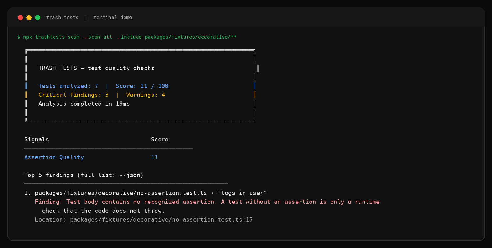

<p align="center">
  
</p>

<h1 align="center">Trash Tests</h1>

<p align="center"><strong>Find weak tests before they become a false CI signal.</strong></p>

<p align="center">
  Deterministic test-effectiveness checks for JavaScript and TypeScript.
</p>

<p align="center">
  <a href="./LICENSE"></a>
  <a href="./.github/workflows/ci.yml"></a>
  
  
</p>

## What Trash Tests checks

A passing test suite and high coverage do not guarantee that tests protect behavior. Trash Tests reviews test code for weak assertions, explains the finding, and produces a clear report for local development and pull requests.

<p align="center">
  
</p>

The report above is generated from the repository's decorative fixture corpus. It shows the score, finding counts, measured signals, and a concrete location to review.

```text
TRASH TESTS — test quality checks

24 tests analyzed. Score: 72 / 100
1 weak test and 2 warnings found.

1. src/profile.test.ts › "loads a profile"
   Finding: Test body contains no recognized assertion.
```

## Quick start

Run against changed tests in the current repository:

```bash
npx trashtests scan
```

Run a full repository review:

```bash
npx trashtests scan --scan-all
```

Include Istanbul coverage data when it is available:

```bash
npx trashtests scan --coverage ./coverage/coverage-final.json
```

Use structured output in automation:

```bash
npx trashtests scan --json > trashtests-report.json
npx trashtests scan --markdown > trashtests-report.md
```

## GitHub Action

Add Trash Tests to pull requests to review changed test files and publish a concise summary.

```yaml
name: Test quality

on:
  pull_request:
    paths:
      - '**/*.js'
      - '**/*.jsx'
      - '**/*.ts'
      - '**/*.tsx'

permissions:
  contents: read
  pull-requests: write

jobs:
  trash-tests:
    runs-on: ubuntu-latest
    steps:
      - uses: actions/checkout@v7
        with:
          fetch-depth: 0

      - uses: actions/setup-node@v7
        with:
          node-version: 20
          cache: npm

      - run: npm ci
      - run: npm test -- --coverage

      - name: Review changed tests
        uses: frangelbarrera/trash-tests/packages/github-action@v1
        with:
          post-comment: true
          coverage-path: ./coverage/coverage-final.json
```

Run the Action with `pull_request`, not `pull_request_target`, when analyzing code from forks. Keep write permissions and secrets away from untrusted pull-request code. The `v1` reference is the stable major-release tag for workflow consumers.

## Checks

| Check | Severity | Purpose |
|---|---|---|
| [`no-assertion`](./docs/rules/no-assertion.md) | Critical | Finds executable tests with no recognized assertion. |
| [`trivial-assertion`](./docs/rules/trivial-assertion.md) | Warning | Finds tautologies and isolated low-signal assertions. |

Trash Tests supports JavaScript and TypeScript test files and recognizes Vitest, Jest, Mocha, Ava, Node assertions, fast-check, common type assertions, and Vitest Browser assertions. When coverage data is supplied, it also reports repository branch coverage.

## Configuration

Create a configuration file with:

```bash
npx trashtests init
```

The generated `trashtests.config.ts` controls scanning scope, score weights, thresholds, disabled checks, and documented suppressions. See [`docs/configuration.md`](./docs/configuration.md) for the complete configuration reference.

## Development

```bash
pnpm install --frozen-lockfile
pnpm lint
pnpm typecheck
pnpm build
pnpm test
pnpm verify
```

`pnpm verify` runs formatting, type checks, builds, tests, score-stability checks, and a clean npm package-consumption test.

For contribution guidance, read [`CONTRIBUTING.md`](./CONTRIBUTING.md). For release steps, read [`RELEASING.md`](./RELEASING.md). For security reporting, read [`SECURITY.md`](./SECURITY.md).

## License

Trash Tests is available under the [Apache License 2.0](./LICENSE).
